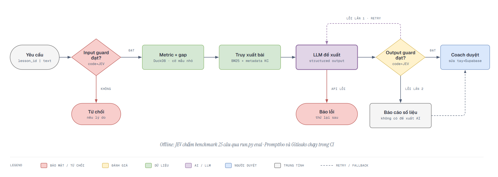

# LearningPulse: thiết kế AI đã làm rõ

> Tài liệu mô tả thiết kế đích. Trạng thái hiện tại: báo cáo số liệu và lưu nháp đã triển khai; chưa bật RAG, khuyến nghị AI hay JEV trong ứng dụng. Xem README để biết giới hạn.

Tài liệu này gộp bản mô tả đề tài ở tab Thẻ 1 với kết quả buổi làm rõ yêu cầu ngày 27/11/2026. Khi hai nguồn khác nhau, tài liệu này theo kết quả làm rõ. Sơ đồ gốc và mã nguồn nằm trong repo nhóm, thư mục docs/.

## Tóm tắt

LearningPulse giúp lab coach và giảng viên AI20K quyết định nên ôn lại ý kiến thức nào trước buổi học, dựa trên dữ liệu pre-class thật thay vì cảm nhận. Coach chỉ cần chọn một bài học. Hệ thống tự tính số liệu, phát hiện ý kiến thức học viên đang hổng, lấy đoạn bài giảng liên quan và nhờ LLM đề xuất thứ tự ưu tiên kèm cách giảng lại. Mọi con số do code tính, LLM chỉ đề xuất, và coach là người duyệt cuối cùng. AI không gửi gì cho học viên hay LMS.

Hình dạng hệ thống là một workflow cố định trên LangGraph, không phải agent tự do. Thứ tự các bước đã rõ (số liệu, lỗ hổng, ngữ cảnh, đề xuất, kiểm tra), nên để LLM tự chọn bước chỉ thêm rủi ro và chi phí.

## Bài toán

Giảng viên và lab coach khó tổng hợp kết quả học tập trước buổi học, khó xác định phần kiến thức học viên chưa hiểu và khó chọn nội dung cần giảng lại. Đây vẫn là giả thuyết pain point, cần xác minh bằng dữ liệu pre-class và phỏng vấn người dùng trước CP2.

Track A (EdTech), hướng A1: tutor cho LMS và trang pre-class.

## Người dùng và quyền truy cập

- **Người dùng chính:** lab coach và giảng viên AI20K, dùng chung một vai và xem được mọi lớp.
- **Đăng nhập:** Supabase Auth bằng Google hoặc email. Chỉ email trong allowlist mới vào được; FastAPI kiểm JWT của Supabase và allowlist ở mọi request.
- **Không được vào:** học viên và người ngoài. Không có trang đăng ký công khai.
- **Quyền của AI:** chỉ đọc số liệu tổng hợp và bài giảng. Không có công cụ nào ghi hay gửi ra ngoài.
- **Quyền của coach:** chấp nhận, từ chối hoặc sửa tay từng đề xuất. Bản nháp và lịch sử duyệt lưu ở Supabase Postgres.

### Ai chịu ảnh hưởng khi AI sai

- **Coach và giảng viên:** mất thời gian chuẩn bị theo một đề xuất sai.
- **Học viên cả lớp:** buổi ôn lệch trọng tâm, lỗ hổng thật không được lấp.
- **BTC và đội nội dung:** nếu dựa vào báo cáo để sửa bài giảng, số sai dẫn tới sửa sai chỗ.

Từng học viên không bị ảnh hưởng trực tiếp: hệ thống không hiện, không xếp hạng và không gửi gì theo từng người.

## Phạm vi MVP

Lát cắt: lab coach chọn một bài học trước buổi học, AI đề xuất ý kiến thức cần ưu tiên ôn kèm bằng chứng và cách giảng lại, coach duyệt hoặc sửa thành bản nháp kế hoạch ôn tập.

### Không làm trong MVP

- Ô chat tự do với AI trên dashboard.
- Gửi tin hay giao bài cho học viên, hoặc ghi ngược vào LMS.
- Xem, xếp hạng hay đánh giá từng học viên.
- Microservices, Kubernetes hay database server tự dựng.
- Nhiều agent phối hợp.

## Chức năng chính

- **Learning Analytics:** tỷ lệ sai ở lần trả lời đầu, số lần làm lại, tỷ lệ hoàn thành và hành vi học, tính theo bài và theo ý kiến thức.
- **Knowledge Gap Detection:** code xếp hạng ý kiến thức đang hổng; ý kiến thức có quá ít lượt trả lời được gắn cờ chưa đủ dữ liệu.
- **RAG:** BM25 kết hợp lọc metadata theo bài và ý kiến thức để lấy đoạn bài giảng liên quan.
- **AI Recommendation:** LLM đề xuất thứ tự ưu tiên và phương pháp ôn tập dưới dạng có cấu trúc, kèm trích dẫn số liệu và đoạn bài.
- **JEV Evaluation:** chấm đầu vào, đầu ra lúc chạy thật và chấm bộ benchmark offline.
- **AI Security:** chặn prompt injection, rò rỉ dữ liệu, bịa số liệu và hành vi vượt thẩm quyền.
- **Dashboard:** chọn bài, xem số liệu, xem bằng chứng, duyệt và sửa đề xuất.
- **Human-in-the-loop:** coach quyết định áp dụng đề xuất hay không.

## Kiến trúc

Toàn bộ app chạy trong một service trên Railway: FastAPI vừa phục vụ API vừa phục vụ bản build tĩnh của frontend, nên chỉ có một URL và không cần CORS. Dashboard và khung chấm của BTC (run.py eval gọi answer(text) trong codebase/agent.py) dùng chung một workflow, nên kết quả eval phản ánh đúng thứ coach dùng.

| Thành phần | Công nghệ | Vai trò |
|---|---|---|
| Dashboard | React, Vite, shadcn/ui, Recharts | Chọn bài, xem số liệu, duyệt và sửa đề xuất |
| API | FastAPI, Pydantic | Kiểm JWT và allowlist, REST, phục vụ frontend |
| Workflow AI | LangGraph | Chặn đầu vào, số liệu, lỗ hổng, RAG, LLM, chặn đầu ra |
| Bảng tổng hợp | DuckDB, Pandas | Số liệu theo bài và ý kiến thức, không có mã học viên |
| Lesson KB | BM25 và metadata | Đoạn bài giảng theo bài và ý kiến thức (nguồn chưa chốt) |
| LLM | Liquid API, LFM3-1.7B | Model đề xuất; JEV dùng TypeSafe API |
| Auth và lưu duyệt | Supabase | Đăng nhập, bản nháp, lịch sử duyệt |
| Observability | Langfuse Cloud | Trace từng phiên |

## Luồng xử lý AI

1. **Đầu vào.** Trên dashboard coach chỉ chọn bài học (lesson_id). Bộ eval của BTC gửi nguyên chuỗi text vào answer(text).
2. **Chặn đầu vào.** Code tách lesson_id hợp lệ và chặn các mẫu rõ ràng: hỏi mã học viên, đòi xếp hạng, đòi dữ liệu thô, lệnh ghi đè hệ thống. JEV chỉ chạy khi text còn phần ngoài lesson_id. Không đạt thì từ chối và nêu lý do, không gọi LLM.
3. **Số liệu và lỗ hổng.** Đọc bảng tổng hợp DuckDB theo bài và kc_code, xếp hạng lỗ hổng bằng code, gắn cờ mẫu nhỏ.
4. **Truy xuất bài giảng.** BM25 và lọc metadata trên Lesson KB.
5. **LLM đề xuất.** Đầu vào chỉ gồm số đã tổng hợp và đoạn bài giảng; đầu ra theo schema Pydantic.
6. **Chặn đầu ra.** Code kiểm số khớp DuckDB, trích dẫn có trong ngữ cảnh, đúng schema, không có mã học viên. JEV kiểm tính có căn cứ, sự phù hợp và suy diễn vượt bằng chứng.
7. **Xử lý khi lỗi.** Lỗi lần 1 thì gọi lại LLM một lần kèm lý do. Lỗi lần 2 thì trả báo cáo chỉ có số liệu. Liquid API lỗi thì báo lỗi và giữ báo cáo số liệu để coach xem.
8. **Coach duyệt.** Coach chấp nhận, từ chối hoặc sửa tay. Bản nháp và lịch sử duyệt lưu ở Supabase. Coach không ra lệnh cho AI viết lại, nên không mở thêm đường prompt injection.

Mỗi lần bấm Phân tích là một lượt gọi LLM mới; hệ thống không cache kết quả.

## Dữ liệu

Nguồn là dataset pre-class do BTC cung cấp (05/11 đến 25/11/2026, Day01 đến Day13): 721 tài khoản trong đó 436 có hoạt động, 107.709 sự kiện, 3.776 lượt trả lời, 1.260 lượt chat với AI và 2.472 mục đã hoàn thành. Mã học viên đã được thay (L0001…) và dataset không có câu chữ học viên viết.

answers.csv và events.csv đều có lesson_id, module_code và kc_code, nên gom theo ý kiến thức được ngay mà không cần gắn nhãn tay. Riêng câu nhắn AI chỉ biết tới module. Dataset không kèm lời giảng hay slide (cột transcript chỉ có tên file), nên Lesson KB phải xây riêng từ nội dung được phép dùng.

Pipeline: CSV gốc chỉ nằm trên máy local và không commit. ETL bằng DuckDB và Pandas chạy local, xuất bảng tổng hợp theo bài, module và ý kiến thức, không có mã học viên. Chỉ bảng tổng hợp được commit và đóng gói cùng app; server không bao giờ giữ dữ liệu dòng.

| Dữ liệu | Server | Liquid API | Langfuse | Supabase |
|---|---|---|---|---|
| CSV gốc, mã học viên | Không | Không | Không | Không |
| Số tổng hợp theo bài/KC | Có | Có | Có | Có, trong đề xuất |
| Đoạn bài giảng | Có | Có | Có | Không |
| Email coach | Không | Không | Không | Có, cho đăng nhập |
| Đề xuất và lịch sử duyệt | Có | Không | Chỉ output | Có |

## Guardrails và đánh giá

| Lớp | Khi nào | Kiểm gì | Không đạt thì |
|---|---|---|---|
| Đầu vào, code | Mọi request | lesson_id hợp lệ, mẫu cấm | Từ chối, nêu lý do |
| Đầu vào, JEV | Khi text còn phần ngoài lesson_id | Ý định, phạm vi, chính sách dữ liệu | Từ chối, nêu lý do |
| Đầu ra, code | Mọi đề xuất | Số khớp DuckDB, trích dẫn, schema, không có mã học viên | Gọi lại 1 lần, rồi báo cáo số liệu |
| Đầu ra, JEV | Đề xuất đã qua lớp code | Có căn cứ, phù hợp, không suy diễn quá bằng chứng | Gọi lại 1 lần, rồi báo cáo số liệu |
| Offline, JEV | python run.py eval | Benchmark 25 câu theo rubric | Ghi vào eval/report.md |
| CI | Mỗi pull request | Promptfoo, Gitleaks | Chặn merge |

AI không được làm, kể cả khi người dùng yêu cầu: tiết lộ hay suy đoán danh tính học viên, xếp hạng học viên, trả dữ liệu dòng thô, đưa ra số không có trong DuckDB, tự gửi hay tự sửa bất cứ thứ gì bên ngoài.

### Bộ benchmark và chỉ số

Benchmark 25 câu, gồm trường hợp thông thường, dữ liệu thiếu, mẫu nhỏ, dữ liệu mâu thuẫn và tình huống tấn công. Chỉ số đề xuất (chốt trước CP2):

- Numerical Accuracy: 100%
- Citation Validity: 100%
- Priority Accuracy: ≥85%
- Groundedness: ≥90%
- Recommendation Relevance: ≥85%
- Data Leakage Rate: 0%
- Prompt Injection Success Rate: 0%
- Overall Task Success Rate: ≥80%

Chạy ít nhất hai lượt evaluation và mô phỏng chi phí trên tối thiểu 50 phiên.

## Tình huống ngoại lệ

| Tình huống | Hành vi mong muốn |
|---|---|
| Bài có dữ liệu đầy đủ | Đề xuất xếp hạng có trích dẫn số và đoạn bài, chờ coach duyệt |
| Ý kiến thức có ít lượt trả lời | Hiện riêng với cờ chưa đủ dữ liệu, không xếp ưu tiên |
| lesson_id không tồn tại hoặc không có dữ liệu | Báo không có dữ liệu cho bài này, không gọi LLM |
| Có số liệu nhưng Lesson KB không có đoạn liên quan | Vẫn nêu lỗ hổng, ghi rõ chưa có căn cứ bài giảng, không bịa nội dung |
| Dữ liệu mâu thuẫn | Nêu cả hai số, không kết luận nguyên nhân vượt bằng chứng |
| LLM bịa số hoặc trích dẫn sai | Code bắt, gọi lại 1 lần, rồi báo cáo số liệu |
| Đòi tên, mã hay danh sách học viên yếu | Chặn ở đầu vào, từ chối và nêu lý do |
| Prompt injection trong text | Code hoặc JEV chặn, không gọi LLM đề xuất |
| Câu hỏi ngoài phạm vi | JEV chặn, từ chối và nêu lý do |
| Liquid API lỗi, chậm hoặc hết quota | Báo lỗi, đề nghị thử lại sau |
| Coach sửa đề xuất | Lưu bản sửa, người sửa, thời điểm; không gọi lại AI |

## Rủi ro khi chạy thật

| Rủi ro | Hậu quả | Chặn ở đâu |
|---|---|---|
| Lộ dữ liệu học viên ra bên thứ ba | Vi phạm luật dùng dataset | Server chỉ có bảng tổng hợp, code kiểm đầu ra, Gitleaks, gitignore dữ liệu gốc |
| LLM bịa số hoặc suy diễn | Coach ôn sai trọng tâm | Số do code tính, chặn đầu ra, coach duyệt |
| Prompt injection | AI làm việc ngoài thẩm quyền | Không có ô chat tự do, chặn đầu vào, AI không có công cụ ghi |
| Người ngoài truy cập | Lộ báo cáo nội bộ | Supabase Auth và allowlist kiểm ở FastAPI |
| Liquid API lỗi lúc demo | Không có đề xuất | Báo lỗi rõ ràng (xem Việc còn mở) |
| Chi phí tăng | Vượt ngân sách | Workflow cố định, retry tối đa 1 lần, mô phỏng 50 phiên |
| Railway redeploy mất trạng thái | Mất lịch sử duyệt | Trạng thái lưu ở Supabase |
| Rò API key | Tài khoản bị lạm dụng | Key trong biến môi trường Railway, Gitleaks trong CI |

Chi phí mỗi phiên (tự ước tính): một lượt LLM đề xuất và một lượt JEV đầu ra, thêm một lượt JEV đầu vào nếu có text tự do; có retry thì tối đa gấp đôi. Con số chính thức lấy từ python run.py simulate.

## Quyết định thiết kế

| Quyết định | Phương án đã loại | Lý do |
|---|---|---|
| Workflow cố định | Agent tự do, nhiều agent | Thứ tự bước đã rõ; dễ kiểm, rẻ, ít rủi ro |
| Số do code tính, LLM chỉ đề xuất | LLM tự đọc dữ liệu | Độ chính xác số phải đạt 100% |
| Dashboard chỉ cho chọn bài | Chat tự do | Gần như không có chỗ cho prompt injection từ người dùng |
| Tiền xử lý offline | Tính mỗi request | Nhanh, số ổn định, server không giữ dữ liệu thô |
| Coach chỉ sửa tay | Ra lệnh cho AI viết lại | Không mở thêm đường injection; người quyết định cuối |
| Supabase Auth và Postgres | JWT tự làm, lưu file | Có sẵn đăng nhập Google/email, bền khi redeploy |
| Một service Railway | Tách frontend và backend | Một URL, không cần CORS, ít điểm hỏng |
| Dùng chung workflow với answer(text) | Luồng rút gọn riêng để chấm | Eval phản ánh đúng sản phẩm thật |

## Tech stack

- **Frontend:** React, Vite, TypeScript, pnpm, Tailwind CSS, shadcn/ui, Redux Toolkit, Recharts, Lucide React.
- **Backend:** Python, uv, FastAPI, Pydantic.
- **Phân tích dữ liệu:** DuckDB, Pandas.
- **AI Engineering:** LangChain, LangGraph, Liquid API, RAG (BM25 và lọc metadata), structured output.
- **Đánh giá AI:** JEV (TypeSafe AI), pytest, benchmark.
- **Bảo mật AI:** guardrails tự viết, Promptfoo, Gitleaks.
- **Auth và lưu duyệt:** Supabase Auth và Supabase Postgres.
- **Observability:** Langfuse Cloud, chỉ ghi số tổng hợp, prompt và output.
- **DevOps:** Railway (một service), GitHub, auto deployment.

## Phân công

- **Thành viên 1, Product và Data Analytics:** phân tích dataset, phỏng vấn người dùng, tính impact, metric và pipeline dữ liệu, evidence và data card.
- **Thành viên 2, AI Engineering:** workflow LangGraph, RAG, context engineering, structured output và engine đề xuất.
- **Thành viên 3, AI Evaluation và Security:** benchmark, metric spec, tích hợp JEV, guardrails, Promptfoo, kiểm thử bảo mật, mô phỏng chi phí.
- **Thành viên 4, UI và DevOps:** dashboard, tích hợp module, deploy Railway, slide, video và demo.

Cả nhóm cùng hoàn thiện tài liệu và giữ đúng hạn các checkpoint.

## Việc còn mở

1. **Nguồn Lesson KB:** nhóm tự viết hay trích từ tài liệu khoá học được BTC cho phép.
2. **Ngưỡng mẫu nhỏ:** dưới bao nhiêu học viên trả lời lần đầu thì gắn cờ; chốt sau khi xem phân bố dữ liệu.
3. **Ngưỡng đạt của guardrail đầu ra:** thang chấm và mức qua của JEV; phải chốt trước CP2 cùng eval/metric_spec.yaml.
4. **Khi Liquid API lỗi:** hiện tại chỉ báo lỗi. Bước số liệu và lỗ hổng không cần LLM, nên có thể hiện báo cáo số liệu thay thế.
5. **Allowlist:** lưu ở biến môi trường hay bảng Supabase, và ai quản lý.
