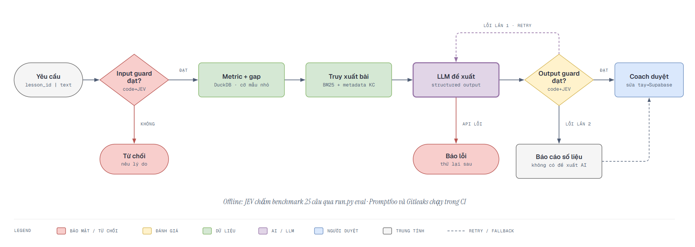

# AI SPEC — [Tên lát cắt] · Nhóm [tên nhóm] · Phòng [XXX] · Zone [X]

> Mốc nộp: §7 chốt chuẩn "đạt" tại **CP2 19:30 Thứ Sáu 27/11** · §0–§7 nộp **CP3 10:00 Thứ Bảy 28/11** · đủ §0–§10 **CP4 14:30 Thứ Bảy 28/11** · §10 changelog ghi tiếp đến **23:59 Thứ Bảy 28/11**.
> Đầu mỗi mục ghi bước guide (`02-guide.md` trong repo đề) chỉ cách điền. Mỗi mục ngắn, có số và nguồn; chi tiết để ở file được trỏ tới. Xoá dòng hướng dẫn trong ngoặc vuông khi điền xong.

Track: [ ] A · [ ] B · [ ] C · [ ] D · [ ] E — bài toán: [đề gợi ý trong file track, hoặc bài toán nhóm tự mở rộng] __
Data BTC cấp đã dùng (nếu có — không commit nguyên file): __

## §0. Hiện tại việc này diễn ra thế nào *(guide 1.1)*
- Luồng hiện tại của việc này, trong khoá hoặc trên app thật (3–5 bước; ảnh chụp từ tài khoản của mình, đã che thông tin):
- Công cụ / AI đang được dùng cho việc này (nếu có) + nguồn. Không kiểm được thì ghi "chưa kiểm":

## §1. Người dùng & bằng chứng *(guide 1.1, 1.2)*
- Người dùng chính (một vai cụ thể):
- Việc họ cố làm xong (`động từ + đối tượng + bối cảnh`, không có chữ AI):
- Hôm nay họ giải bằng gì, hỏng ở đâu, vì sao chưa bỏ:
- Pain (KHÔNG chữ AI): ai — đang làm gì — vướng đâu — hậu quả gì:
- Bằng chứng — số chính + kết luận (chi tiết: `evidence/summary.md`): __

## §2. Impact & quyết định chọn *(guide 1.3)*

| Hướng | Bao nhiêu người gặp | Bao nhiêu lần / tháng | Mỗi lần tốn gì | Impact / tháng | Làm kịp không | Chọn? |
|---|---|---|---|---|---|---|
|  |  |  |  |  |  |  |
|  |  |  |  |  |  |  |
|  |  |  |  |  |  |  |

- **Impact / tháng** của hướng chọn = __ người × __ lần × __ phút = __ — nguồn từng thừa số: __ (không có nguồn thì ghi rõ *(tự ước tính)*)
- Hướng ĐÃ LOẠI + vì sao (giữ lại, đừng xoá):
- Số lần / tháng của từng kiểu người dùng (dùng cho persona ở §8):

## §3. Giải pháp tương tự *(guide 2.1)*
- [sản phẩm / tính năng gần giống]: một điều đáng học · một điều đáng né · mình khác gì

## §4. Thiết kế *(guide 2.2, 3.2)*
- **Lát cắt MỘT CÂU** (1 người dùng · 1 việc · 1 quyết định AI · 1 kết quả):
- Không làm (≥3 điều):
- **Sơ đồ** (ảnh / Mermaid / draw.io):

  

  Sơ đồ kiến trúc hệ thống và ranh giới dữ liệu: [docs/architecture-diagram.html](docs/architecture-diagram.html) · mô tả chi tiết: [docs/architecture.md](docs/architecture.md)
- **Hình dạng:** [ ] workflow cố định · [ ] một agent · [ ] nhiều agent — 2 dòng lý do, và vì sao **không** chọn hình dạng phức tạp hơn:
- **AI dựa vào đâu** — mỗi công cụ (khớp `codebase/tools.py`):

  | Công cụ | Input | Output | Tác động ra ngoài? |
  |---|---|---|---|
  |  |  |  |  |

- **Mức tự động:** [ ] AI gợi ý, người quyết · [ ] AI tự làm khi chắc, chuyển người khi không · [ ] AI tự làm — lý do (sai thì ai chịu gì, sửa đắt hay rẻ):
- **Chỗ chặn rủi ro** (rủi ro lớn nhất của lát cắt bị chặn ở đâu, bằng gì):
- **Chỗ người duyệt** (việc AI không được tự làm):
- **Nguyên tắc thiết kế** (≥3, bắt buộc G10):

  | Nguyên tắc | Chỗ cụ thể trên sơ đồ / trong bản chạy thử |
  |---|---|
  | G10 — thu hẹp phạm vi khi không chắc |  |
  |  |  |
  |  |  |

- Phần nào còn giả (công cụ trả dữ liệu giả, model chế độ giả…) — ghi rõ, không giả làm thật:

## §5. Chỗ khó — 4 lớp + ≥6 kịch bản + 2 tấn công *(guide 2.3)*

| Kịch bản | Lớp (1–4) | Hành vi mong muốn (nói gì, hiện gì, cho làm gì tiếp) | Câu thử |
|---|---|---|---|
|  |  |  |  |
| *(tấn công)* |  |  |  |
| *(tấn công)* |  |  |  |

(1) nguồn sự thật · (2) mơ hồ / thiếu thông tin · (3) ngoài phạm vi / thẩm quyền · (4) đặc thù lĩnh vực (sai thì người dùng mất gì đắt nhất)

## §6. Bốn đường đi của trải nghiệm
- Mọi thứ suôn sẻ: · Không chắc (lớp 2): · Không có căn cứ (lớp 1): · Người dùng sửa:
- Bị đòi ngoài phạm vi (lớp 3): · Trường hợp đặc thù lĩnh vực (lớp 4):

## §7. Đánh giá & chuẩn "đạt" *(guide 2.4, 4.1)*

- **Bộ đánh giá CP2.** [Data Card](data/DATA_CARD.md) mô tả nguồn và cách lọc dữ liệu. [Benchmark](eval/benchmark.csv) có 15 câu gồm 7 `thuong`, 5 `kho` và 3 `tu_choi`. Người chấm ghi `pass=1` khi câu trả lời thỏa toàn bộ `pass_criterion` của dòng và mọi tiêu chí áp dụng cho câu đó. Câu thiếu output hoặc gặp lỗi tính là trượt.
- **Chuẩn “đạt” chốt tại CP2.** Một lượt đạt khi ≥90% tổng số câu qua (ít nhất 14/15 câu ở CP2) và cả bốn [metric](eval/metric_spec.yaml) đạt ngưỡng riêng. Trên các câu áp dụng cho từng metric, yêu cầu đúng số liệu ≥90% (ít nhất 11/12), chọn đúng nội dung ôn 100% (6/6), xử lý thiếu căn cứ 100% (5/5) và giữ đúng thẩm quyền 100% (3/3). Mỗi câu chỉ tính một lần trong tỷ lệ chung. Các ngưỡng phần trăm được giữ đến 23:59 ngày 28/11/2026.

## §8. Chi phí khi dùng thật *(guide 4.2)*
- Persona + giá: `cost/personas.yaml` · lượt mô phỏng: `cost/simulate-__.csv` (__ phiên)
- Chi phí / task thành công: __ (model __) · __ (model __)
- Chi phí / tháng ở quy mô thật: thấp __ · cơ sở __ · cao __ → chi tiết `cost/cost-estimate.md`
- So với impact / người / tháng (§2): đáng làm không, vì sao:

## §9. Rủi ro & an toàn
- Dữ liệu: đã ẩn danh gì, không thu gì, không đưa gì vào model gói miễn phí:
- AI **không được** làm gì kể cả khi người dùng yêu cầu:
- Ai có thể bị hại nếu AI sai, và nhóm chặn thế nào:

## §10. Phân công & changelog
- Phân công có tên (theo chặng, chia cặp — guide "Cách chia việc"): __
- Dùng AI vào việc gì (2–3 dòng; chi tiết `docs/ai-usage.md`):
- Nhật ký thay đổi — **mọi thay đổi sau CP2 19:30 Thứ Sáu 27/11 phải có dòng ở đây**:

**CP2 → CP4** (vd thu hẹp lát cắt, hỏi thêm người dùng, lần cải tiến trước lượt 2)

| Thời điểm | Đổi gì | Vì sao (trỏ về câu thử / lỗi / bằng chứng nào) |
|---|---|---|
| 27/11 19:36 | Áp dụng ngưỡng 10 lượt được chấm để xếp ưu tiên; che số liệu nhóm dưới 5 học viên. Chuẩn bị module BM25 và JEV, chưa bật đề xuất AI. | Đồng bộ quyết định CP2 trong `canvas.md`; giảm lộ thông tin nhóm nhỏ, chờ nguồn Lesson KB và hiệu chuẩn JEV. |
| 27/11 19:39 | Cập nhật hướng dẫn snapshot, cấu hình secret và trạng thái triển khai trong README. | Tài liệu phải khớp luồng báo cáo và dữ liệu thực tế sau CP2. |
| 27/11 19:58 | Chuẩn bị module thử nghiệm kiểm trích dẫn, số liệu và điều phối Liquid/JEV; chưa bật trong ứng dụng. | Cần có căn cứ để kiểm đầu ra; còn chờ Lesson KB và hiệu chuẩn JEV trước khi dùng thực tế. |
| 27/11 20:05 | Cập nhật tài liệu thiết kế: Liquid API cho LFM3-1.7B, TypeSafe API cho JEV. | Khớp lựa chọn nhà cung cấp của nhóm; giữ báo cáo số liệu khi model lỗi. |
| 27/11 21:01 | Hiện số liệu tổng hợp cho KC mẫu nhỏ; tiếp tục gắn cờ và không xếp ưu tiên dưới 10 lượt được chấm. | Theo quyết định của nhóm để đáp ứng câu thử về mẫu nhỏ; không hiện dữ liệu từng học viên. |
| 27/11 21:04 | Thêm bí danh `Day NN` cho CLI và làm rõ prompt/JEV trong module thử nghiệm; chưa bật AI trong ứng dụng. | Hỗ trợ chọn bài theo cách gọi phổ biến và hạn chế diễn giải sai số liệu; cần kiểm thử thêm trước khi nối workflow. |
| 27-11 21:12 | Bổ sung từ chối sớm các yêu cầu rõ ràng về thông tin cá nhân, bí mật và tự phê duyệt/gửi. | Bảo vệ phạm vi theo các tiêu chí giữ đúng thẩm quyền trong `eval/metric_spec.yaml`; chưa bật xử lý câu hỏi tự do. |
| 27-11 21:10 | Đồng bộ nhãn nhà cung cấp trong sơ đồ kiến trúc sang Liquid API. | Khớp lựa chọn LFM3-1.7B qua Liquid API của nhóm. |

**Sau CP4 (đến 23:59 Thứ Bảy 28/11)** (sửa theo góp ý — không sửa chuẩn "đạt", câu thử, số bằng chứng, kết quả các lượt đã chạy)

| Thời điểm | Đổi gì | Vì sao |
|---|---|---|
|  |  |  |
